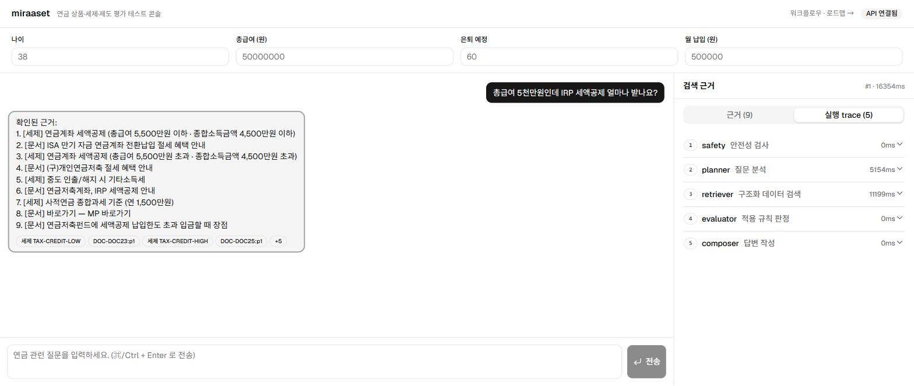

# 연금 QA 에이전트 — 근거를 함께 돌려주는 답변 API

연금 상품·세제·제도 문서를 근거로 질문에 답하고, **어떤 근거를 보고 어떤 단계를 거쳐 답했는지**를 함께 돌려주는 평가용 에이전트입니다.

- 2026 미래에셋 AI 페스티벌 출품 · 팀 프로젝트(개발 3인) · 2026-08-08 ~ 09-06(30일)
- **내 역할: 백엔드 — 평가 API 계약, 답변 사후 검증(수치 대조·검산), 검색 색인, 배포·CI, 적재 관측, 골든 QA 채점**
- 내 기여: 커밋 251개(머지 제외) · PR 187건 · 이슈·PR 코멘트 345건

> 이 저장소는 공개용 소개 페이지입니다. 원본 코드와 이슈·PR은 주최 측 조직의 비공개 저장소에 있어 여기에 옮기지 않았습니다.
> 대회 제공 자료(투자설명서 원문, 평가 문항)도 재배포하지 않습니다.




## 무엇을 만들었나

주최 측이 `GET /answer`로 질문을 보내면, 에이전트가 근거 문서를 찾아 답하고 채점용 5필드를 돌려줍니다.

```
GET /api/v1/answer?question_id={id}&question={질의}
→ { "question_id", "question", "retrieved_context", "think_trace", "answer" }
```

답변 옆에는 근거(인용한 문서·세제 규칙)와 실행 trace(단계별 판단과 소요 시간)가 붙습니다.
채점자가 "왜 그렇게 답했는지"를 확인할 수 있게 하는 것이 목표였습니다.


## 구조

```
질문 ─▶ safety ─▶ planner ─▶ retriever ─▶ evaluator ─▶ composer ─▶ postcheck ─▶ 응답 봉투(5필드)
       인젝션 차단   의도·키워드   PostgreSQL    프로필을 규칙에   근거 인용      생성 후 검증
       개인정보 마스킹 (LLM)        전문 검색      대입해 판정       답변(LLM)      (코드)
```

| 영역 | 기술 |
|---|---|
| API | FastAPI · Python 3.12 · Pydantic |
| DB | PostgreSQL 17 · Alembic(EAV 스키마: 상품·클래스·위험등급·사실·규칙) |
| 검색 | PostgreSQL 전문 검색 — 한국어 형태소 `tsvector` 주 경로 + `ILIKE` 폴백, BM25 순위 |
| LLM | HyperCLOVA X(planner·composer 두 자리, 키가 없으면 규칙 경로) |
| 화면 | React 19 · TypeScript · Vite(시연·채점 확인용 콘솔) |
| 배포 | Docker Compose · Caddy(HTTPS) · GHCR · GitHub Actions(셀프 호스티드 러너) · 네이버 클라우드 |

검색에 벡터 DB(pgvector)는 쓰지 않았습니다. 형태소 색인이라 `연금저축계좌를` 같은 조사 변형도 맞고, 나중에 임베딩 검색으로 바꿔도 `search_*` 함수 시그니처만 지키면 에이전트 쪽은 고치지 않게 나눠 두었습니다.
기본 `ts_rank`에는 IDF가 없어 흔한 낱말(`투자`는 6,239면 중 5,873면에 등장)을 많이 맞춘 면이 정답면을 밀어냈고, 팀원이 BM25로 바꾼 뒤 같은 질의·같은 후보에서 상위 5위 개선 4건, 회귀 0건이었습니다(색인 배관은 내 작업, BM25 순위는 팀원 작업).

## 핵심 설계 결정

**1. 숫자는 LLM에 부탁하지 않고 코드가 막는다.**
"숫자를 지어내지 마라"고 프롬프트에 쓰는 대신, 응답을 내보내기 직전에 코드가 답변 속 모든 수치를 근거의 수치 집합과 대조합니다. 근거에 없는 수치가 든 문장은 지우고 한계 블록에 기록합니다. 산술식(예: `6,000만원 ÷ 12`)은 코드가 다시 계산해 맞춰 봅니다.

**2. `GET /answer` 계약은 어떤 입력에도 깨지지 않는다.**
파라미터 이름이나 경로가 한 글자만 어긋나도 채점 문항 전체가 실패합니다. 그래서 별칭 파라미터와 별칭 경로를 받고, 빈 질의나 파이프라인 실패에도 **HTTP 200 + 5필드**를 돌려줍니다. 응답 봉투는 LLM이 아니라 코드가 조립합니다.

**3. 헬스체크와 데이터 결손 관측을 나눈다.**
코퍼스가 비어도 `/answer`는 200과 5필드를 냅니다. 계약은 지켜지는데 근거만 없는 상태라 `/health`로는 안 보입니다. 그래서 `/api/v1/health/corpus`를 따로 두고 결손이면 503을 냅니다. 이 경로는 배포 롤백 판정에 물리지 않습니다 — 멀쩡한 배포를 롤백하지 않도록, **경보는 하되 배포는 막지 않습니다.**

**4. 연금 계산식은 코드가 쥔다(팀 결정, 계산기 구현은 팀원 · 나는 답변 산술을 다시 계산하는 사후 검산을 맡음).** 계산식이 확정돼 있고 피연산자가 질문에 다 있으면, LLM이 틀린 결과(예: `6,000만원 ÷ 12`를 50만원으로)를 낸 자리에 코드가 결과 문장을 붙입니다.

## 내가 한 일

팀 성과와 구분해, 내 커밋으로 확인되는 일만 적습니다.

- **평가 API와 응답 계약** — `GET /answer` 구현, 관대한 진입점(별칭 파라미터·경로, 422 함정 제거), 공개 경로를 셋으로 축소, 코드가 조립하는 응답 봉투.
- **답변 사후 검증·검산** — 생성 후 검증(답변 수치 ↔ 근거 대조) 첫 구현과 이후 결함 수정: `만`·`억` 단위 환산, `2억원`이 `2`로 읽히던 피연산자 단위, `1,500만원` = `15,000,000` 같은 단위 펴기, `23.6200%`와 `23.62%`를 다른 수로 보던 끝자리 0, 내부 표기(`synth_fee` 등)가 답변에 새던 것, 내부 지시문 누출 제거.
- **검색 색인과 결손 수정** — 한국어 형태소 `tsvector` 색인 배관, EAV 스키마 전환, 페이지·표 이원 색인(`search_units`). 수익률 181행이 검색에서 이중으로 막혀 있던 것, 검색이 펀드 클래스를 거르지 않던 것, 라벨 오염 접두로 159행·23개 펀드가 검색되지 않던 것을 고침.
- **배포·CI** — GitHub-hosted 러너의 분 과금을 피하려고 CI를 네이버 클라우드 셀프 호스티드 러너로 옮김, CI가 하던 회귀 검사를 `deploy.sh`로 옮김, 모든 CI 잡에 시간 상한(상한이 없어 한 잡이 84분을 씀), 셸 스크립트 LF 고정.
- **적재 관측** — 코퍼스 적재를 부팅 경로에서 분리(헬스체크 여유가 7.7초뿐이었음), 문서 단위 실패 격리와 종료 코드, `/api/v1/health/corpus`.
- **골든 QA 채점과 원인 분석** — 일 1회 골든 QA diff를 Actions 스케줄로 돌림. 328문항 회차에서 A절 107문항을 정독 채점(나머지는 이전 판정을 가져왔고, 팀 재채점으로 최종 통과 170 · 부분 101 · 실패 57, 가중 67.2%). 30문항 회차 실패 8건이 검색 실패가 아님을 밝힌 분석 보고.

## 운영하며 해결한 문제

| 문제 | 원인 | 해결 |
|---|---|---|
| 부팅 적재를 켜면 컨테이너가 unhealthy | 부팅 때 코퍼스를 적재하느라 헬스체크 여유가 7.7초뿐 | 적재를 부팅에서 떼어 `deploy.sh`가 헬스 통과 **뒤** 돌리게 함 |
| CI 잡 하나가 84분을 씀 | 잡에 시간 상한이 없었음 | 모든 잡에 `timeout-minutes` |
| 검산 집계가 실제보다 좋게 나옴 | 검산하지 못한 문항을 "통과"로 셈 | "못 쟀다"를 따로 셈 |
| 계산 문항에서 결과 수치가 사라짐 | 사후 검증이 단위 붙은 피연산자(`2억원`)를 잘못 읽어 맞는 결과 문장까지 지움 | 피연산자 단위를 펴서 계산, 문단에서 피연산자를 모음 |

## 결과 수치

| 항목 | 값 |
|---|---|
| 코퍼스 적재 | 150/150 문서, 실패 0 · 검색 단위 19,119행 · CI 실측 198.2초 |
| 응답 시간(30건 실측, 팀원 측정) | 중앙값 11.5초 · 최대 23.1초 |
| 골든 QA(328문항, 팀 재채점 최종) | 통과 170 · 부분 101 · 실패 57 · 가중 67.2% |
| 팀 규모 | 커밋 1,454개(머지 포함) · CI 실행 496회 · 배포 48회 |

## 화면

- `images/02-console-execution-trace.jpg` — 실행 trace 5단계(safety → planner → retriever → evaluator → composer)
- `images/03-roadmap-workflow.jpg` — 팀 워크플로·로드맵 화면

세 장 모두 대회 종료 뒤 보존한 이미지로 로컬에서 띄워 찍었고, 입력 프로필 값은 예시입니다.

## 원본에 대해

- 원본 저장소는 주최 측 조직 소유의 비공개 저장소입니다. 코드, 이슈·PR 대화, 팀원 정보, 대회 제공 자료는 이 저장소에 없습니다.
- 위 기여 수치는 원본 저장소의 git 이력(머지 제외, 같은 사람의 여러 이메일은 하나로 묶음)과 GitHub API로 셌습니다.
